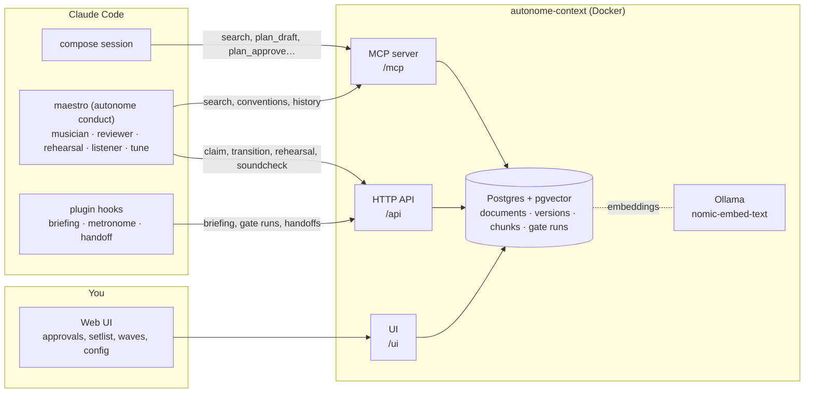
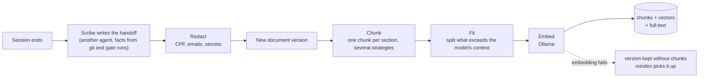
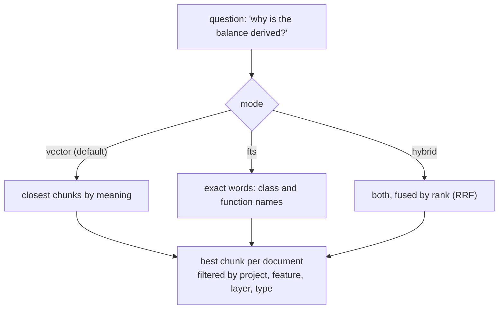
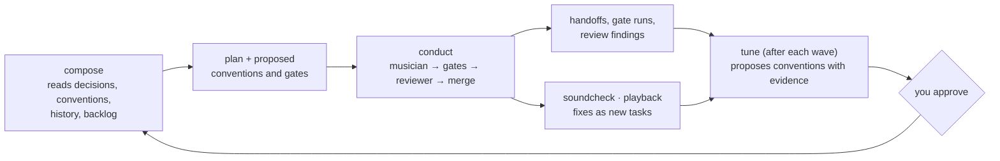
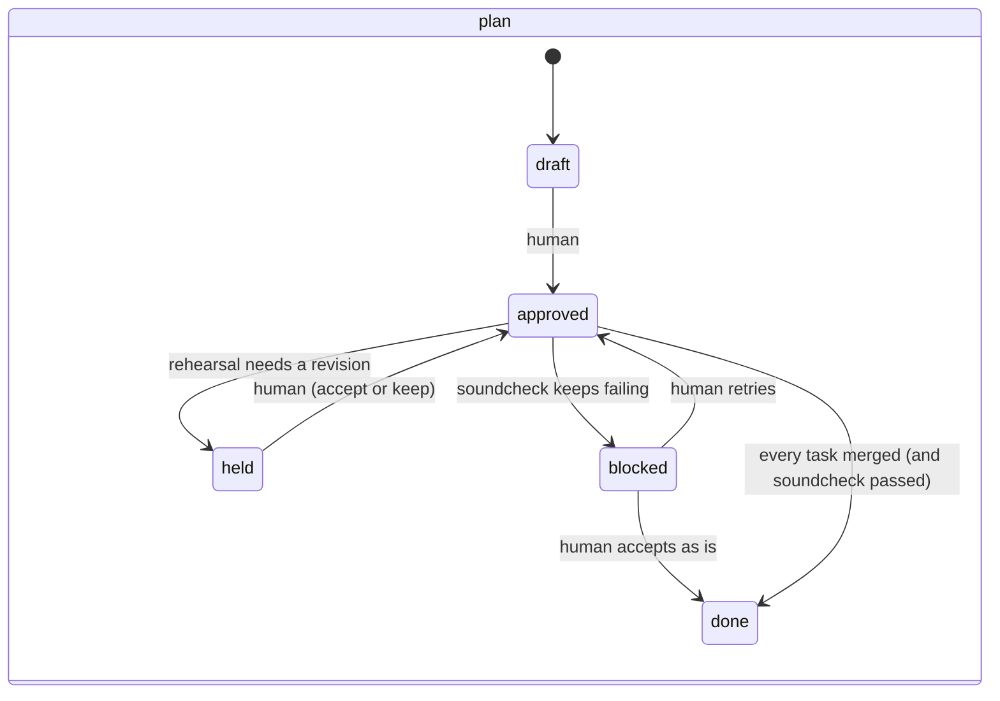
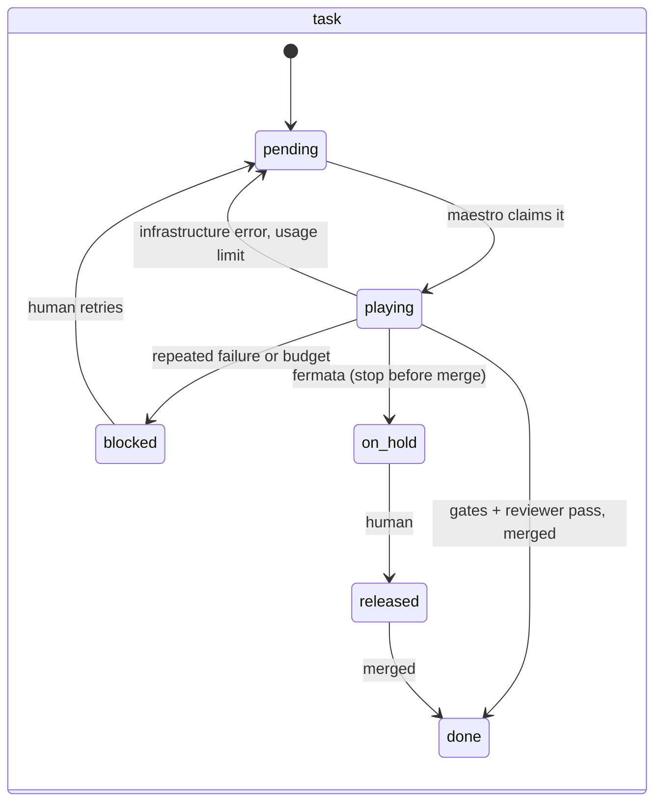

# How the memory works

autonome-context is the project's memory: what was planned, decided, built and learned, kept so
that the next agent starts from it instead of from scratch. Agents read and write it through an MCP
server; the plugin's hooks and the maestro through an HTTP API; the human through the web UI.

## The pieces

Everything binds to localhost. Approvals and edits to conventions and the gate config happen only
in the UI or through a question the client shows the human (MCP elicitation); no agent can make them.

## What it stores

Every item is a **document** with a type, a status, a feature and layers. Changes never overwrite:
each one is a new **version**, and search only sees the latest.

| Type | What | Written by |
|---|---|---|
| `plan` | goal, scope, tasks, the conventions and gates it proposes | compose, with the human |
| `wave` | several plans approved together, in order | compose |
| `task` | one unit the maestro plays, with every run (review, gates, diff, cost) | approval, then the maestro |
| `handoff` | what a session did against its plan: deviations, decisions, friction | the scribe, after every session |
| `decision` | a choice and why (imported ADRs too); a deviation also keeps its `triage_history` | handoffs, `decision_propose`, imports, the runner's triage |
| `convention` | a rule per layer the agents follow and the reviewer enforces | the human, plans, tune |
| `gate_config` | the project's gates, review, models, playback… ([guide](configuration.md)) | the human, in the UI |
| `feature_doc` | the living doc of a feature, and the system overview | the docs scribe, after merges |
| `backlog` | the roadmap's waves, not yet composed | imports |

Plus two tables outside the documents: **gate runs** (every gate result, the facts behind the
metronome and the insights) and the **raw transcripts** of sessions, compressed and never indexed.

## From a session to something searchable

- **Redaction** runs before anything is stored: personal data never reaches the memory.
- **Chunking** is a lab variable: every version is indexed by several strategies (per section with
  context, per section bare, whole document) so they can be compared on the same questions.
- **An indexing failure never fails the write**: the version is saved, and
  `autonome-context reindex` indexes what was left behind.

## How agents find things

Vector search is the default because it measured best (paraphrases, and Portuguese questions over
English text: [retrieval benchmark](benchmarks/retrieval.md)). Vector hits below a cosine similarity
of 0.6 are dropped: on confere-v2, questions unrelated to the project topped out at 0.585 and related
ones started at 0.64, so an empty answer means the memory has nothing on it. Besides `search`, agents get the
memory already shaped for their job:

| Tool or call | Gives | Used by |
|---|---|---|
| briefing (SessionStart) | the task, its plan, the conventions of its layers, earlier friction, rehearsal notes | every session |
| `conventions_get` | the rules of the layers a change touches | compose, musician, reviewer |
| `history_get` | what went off plan before on the same subject: skipped items, deviations and who judged them (`judged_by`: a triage backend or `human`, with the `verdict`), reviewer blocks, fixes, blocked tasks | compose, rehearsal |
| `insights_get` | adherence, gate failures, encores, friction grouped by meaning, advisory review findings, triage verdicts and what happened next, and `convention_effects`: per active convention, findings and friction before and after its adoption (`findings_before/after`, `friction_before/after`, `tasks_after`) and `holding` (true, false, or null when too little history) | tune |
| `plan_get`, `plan_list`, `gate_config_get` | plans and the gates that will judge the work | compose, rehearsal |

## How it learns

The loop closes in two places: **tune** turns what repeated into conventions the next plans start
from, and **compose** reads the history of the same subject so a lesson is applied, not relearned.

## Lifecycles

Only the transitions below exist; the context refuses any other, and those marked *human* only
come from the UI or an elicitation the human answers.

A decision recorded by a handoff is **in effect** unless it departs from the plan or a convention
(a deviation). With the triage on, the **runner** moves a proposed deviation (`proposed → accepted`
or `rejected`) with the classifier's verdict, which is kept in the decision's `triage_history`
(backend, model, the state shown, the answers, the verdict, the round). A rejection queues a task to
undo it; when `max_rounds` run out it stays proposed, marked exhausted, off the queue. A deviation that
follows one rule against another (`rule_conflict`) is escalated: it stays proposed, with no undo task,
in the approvals queue as a non-blocking rule conflict; the decision is marked `triage_conflict` and
insights lists it under `conflicts`. With the triage off it waits for the human as before. Every
reviewer round of a task is kept in the run's `reviews`, with each finding's outcome. Deviations are
triaged, and so is every accepted decision: the runner screens it first (one question, `is_deviation`; the result is kept in the decision's `screening`) and
reopens it as a deviation (`accepted → proposed`, `screened_as_deviation`) when the score reaches
`reject_at`, then the triage judges it as any other. The human's reject outranks the triage: a
decision from the handoff of an undo task for a decision the human rejected is marked
`undo_of_human_reject` and accepted as the human's choice, neither screened nor judged (an undo of a
triage reject is still judged, with its round). Proposed conventions, playback, fermata and blocked
tasks stay with the human. A *playback* task is merged and
waits for the human's review in the background; "needs a fix" becomes a new task.

## Where it lives and how to keep it

The data is the Postgres volume of the `compose.yml` stack. Back up and restore with the commands
in the [configuration guide](configuration.md#5-keeping-the-memory-safe); remove a project with
`autonome-context delete-project`.
